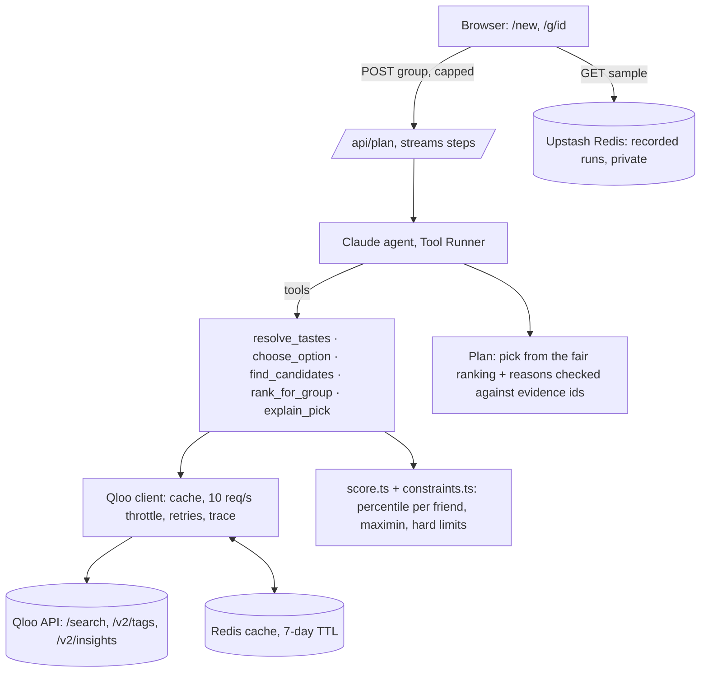

# Common Ground

> A generic AI guesses what your group might like; Common Ground knows what each of you loves and finds the plan where those tastes overlap.

**[Live demo](https://common-ground-phi-bice.vercel.app/)** · [Sample group](https://common-ground-phi-bice.vercel.app/g/birthday-with-amma) · [Without-Qloo comparison](https://common-ground-phi-bice.vercel.app/g/couple-date-night#compare-heading) · [Make your own group](https://common-ground-phi-bice.vercel.app/new) · [How it's built](#how-its-built)

Built for the Qloo Agentic Hackathon. MIT licensed. No sign-up, no keys, nothing to install.

## Try it in a minute

1. Open the sample [**College friends, Bengaluru, Saturday night**](https://common-ground-phi-bice.vercel.app/g/college-friends). Four friends and twelve tastes become one restaurant, with a reason for each friend.
2. Open the X-ray under the plan: every Qloo call, each friend's score for each place, and the evidence each reason cites.
3. Scroll to **Without Qloo vs with Qloo**: the same model with no Qloo tools, side by side.
4. Open [**Flatmates taking Amma out for her birthday**](https://common-ground-phi-bice.vercel.app/g/birthday-with-amma), where simple averaging and our fairness rule pick different places.
5. [**Make your own group**](https://common-ground-phi-bice.vercel.app/new): a live run, about 20–30 seconds, capped at 3 per visitor per day.

Sample pages replay real recorded runs. They load instantly and make no Qloo or model calls. The people in them are fictional; their tastes went through the real agent and real Qloo data.

## The problem

Saturday, 4:10 pm, a WhatsApp group of four. "Where are we going tonight?" Forty messages later: one friend is vegetarian, one is on a budget, one wants a brewery, one says "anything is fine" and then vetoes everything. Someone always ends up organising, and they're guessing what everyone else likes.

Recommenders are built for one person. A group needs a place that works for *everyone*, including the friend whose taste is least like the others, plus one line for each friend on why it works for them, so the organiser can paste it into the chat and be done.

## What it does

| Step | What happens | Qloo capability |
|---|---|---|
| Who's coming | 2–4 friends, a few things each one loves (artists, films, shows, places, dishes), veg and budget limits | — |
| Resolving tastes | Each taste is matched to a Qloo entity or tag. Ambiguous names ("Anirudh") are resolved and stated; misses ("Sid Sriram's new song") are retried and stated, never guessed | `/search`, `/v2/tags` |
| Finding overlap | Candidate restaurants come from everyone's tastes combined, plus each friend's own top places so a minority taste gets a say. Fast-food chains are dropped by tag | `/v2/insights` with location, category, price and popularity filters |
| Scoring for each friend | Every candidate is scored for each friend from that friend's own tastes, along with which of their tastes drove the match | `/v2/insights` with `filter.results.entities` and `feature.explainability` |
| Picking fairly | Hard limits first (veg, budget). Then the place whose least-happy friend is happiest wins, with a tie-break on the average | Deterministic code, not the model |
| Building the plan | One sentence per friend, citing only evidence Qloo returned; a WhatsApp-ready message | Explainability, place tags and properties |

## How it's built



**The model never produces a number.** Claude (`claude-sonnet-5-5`, effort `medium`) decides which tools to call, classifies each taste (artist, film, show, place, food), handles ambiguous and unmatched tastes, and writes one sentence per friend. Matching, scoring, constraints and the pick itself are plain TypeScript with tests. Before the plan is shown, the server keeps only the evidence ids that `explain_pick` actually returned for that friend. A reason with none left is labelled "unverified".

### Feature map: every Qloo call

| # | Qloo capability | Exactly what we send | Code |
|---|---|---|---|
| 1 | Entity search | `GET /search?query=<taste as typed>&types=urn:entity:{artist,movie,tv_show,book,place}&take=3`, then a name-match guard (search always returns *something*) | [`lib/qloo/client.ts`](lib/qloo/client.ts#L175), [`lib/qloo/resolve.ts`](lib/qloo/resolve.ts) |
| 2 | Tag search (food and drink) | `GET /v2/tags?filter.query=<dish>&take=5` → e.g. `urn:tag:specialty_dish:place:filter_coffee` | [`client.ts`](lib/qloo/client.ts#L178), [`steps.ts`](lib/agent/steps.ts#L164) |
| 3 | Group candidate pool | `GET /v2/insights?filter.type=urn:entity:place&filter.location.query=<city>&filter.tags=urn:tag:category:place:restaurant&filter.price_level.min=1&filter.price_level.max=<tightest budget>&filter.popularity.min=0.3&signal.interests.entities=<everyone's>&signal.interests.tags=<everyone's food tags>&take=25` | [`steps.ts`](lib/agent/steps.ts#L249) |
| 4 | Each friend's own top places | Same as #3 with one friend's signals, `take=10`; their top 3 join the pool | [`steps.ts`](lib/agent/steps.ts#L249) |
| 5 | Per-friend scoring of a fixed pool | Same filters, one friend's signals, `filter.results.entities=<pool ids>&feature.explainability=true` → `query.affinity` and which of their tastes drove it | [`steps.ts`](lib/agent/steps.ts#L305) |
| 6 | Explainability → reasons | `query.explainability["signal.interests.entities"]` plus place tags, specialty dishes and descriptions become numbered evidence | [`steps.ts`](lib/agent/steps.ts#L389) |
| 7 | Tags as constraints | `dietary_option:qloo:vegetarian` / `non_vegetarian_restaurant` decide veg; `fast_food`, `pizza_takeout` etc. are dropped | [`steps.ts`](lib/agent/steps.ts#L234) |
| 8 | Scoring the no-Qloo pick | The baseline's restaurant is found with #1 (right city, right branch) and scored like #5 | [`lib/agent/compare.ts`](lib/agent/compare.ts) |

Every response is validated with zod, cached in Redis by request hash, and logged in a per-run trace that the X-ray shows (never the key). A cold plan for four friends makes 18–22 Qloo calls; reruns hit the cache for most of them.

### The agent's tools

| Tool | What it does | Number source |
|---|---|---|
| `resolve_tastes` | Free text → Qloo entities or tags; first lookup must use the words as typed (enforced), retries are kept as a trail | Qloo |
| `choose_option` | Resolves an ambiguous taste to one of the options Qloo returned, and only those | Qloo |
| `find_candidates` | Group pool + each friend's top 3, fast food dropped | Qloo |
| `rank_for_group` | Per-friend scores, hard limits, fair ranking, and what averaging would have picked | Qloo + `score.ts` |
| `explain_pick` | Numbered evidence per friend and per place | Qloo |

## The one interesting idea: a fair overlap

Qloo's affinities for one person across a pool sit close together (0.87–0.94 in our spikes), so we first turn each friend's scores into a percentile within the pool (100 = their favourite there). Then we pick the place whose **least-happy friend is happiest** (maximin), with a tie-break on the average.

From the recorded [birthday sample](https://common-ground-phi-bice.vercel.app/g/birthday-with-amma) (three flatmates who like bars, and Amma, who likes Carnatic music and filter coffee):

| | Kabir | Tanvi | Sameer | Amma | Least happy | Average |
|---|---|---|---|---|---|---|
| Averaging picks The 13th Floor | 74 | **52** | 100 | 87 | 52 | 78 |
| Fairness picks SkyDeck by Sherlock's | 87 | **57** | 61 | 83 | 57 | 72 |

Averaging chases Sameer's 100 and leaves Tanvi with her weakest match; fairness gives up Sameer's favourite to lift the friend at the bottom. The gap is modest, and we report it as measured.

What it took to see any difference at all: when the pool came from one combined Qloo call, averaging and fairness agreed on every sample. The combined call follows the majority's tastes, so places only the odd one out loves never got considered. Adding each friend's own top places to the pool fixed that. That's a product fix, not a demo trick: the friend least like the others should get a say in what's on the table.

## Evidence

**Without Qloo vs with Qloo** (same model, same group, same instructions, no tools; generated once, [stored and shown on each sample page](https://common-ground-phi-bice.vercel.app/g/college-friends#compare-heading)). Each pick is scored for each friend with Qloo over the same pool; the figure is the least-happy friend's percentile.

| Sample | Without Qloo | Least happy | With Qloo | Least happy |
|---|---|---|---|---|
| College friends (4) | Meghana Foods | 0 | The 13th Floor | 71 |
| Couple (2) | Matsuri | 0 (Nisha 100, Arjun 0) | Don't Tell Mama | 81 |
| Birthday with Amma (4) | Windmills Craftworks | 0 | SkyDeck by Sherlock's | 58 |

**Read this with the caveat:** the yardstick is Qloo's own taste model and the pool is Qloo's recommendations, so a pick from outside it tends to rank low. It measures distance from each friend's taste profile, not whether real people would enjoy the night more. A blind check with real people is the stronger test and hasn't been done yet. What needs no Qloo score: the no-Qloo plan for Amma's birthday is priced above her stated budget; its reasons include details nothing backs up ("live jazz vibe", "soft and melodic" music); and it put Matsuri in Indiranagar, while the only Matsuri Qloo knows is on Lavelle Road.

**Failure → recovery**, shown on purpose in the samples:
- "Sid Sriram's new song" has no match as typed → the agent retries as "Sid Sriram" and lists the assumption.
- "Anirudh" matches two artists → the agent picks Anirudh Ravichander and says so.
- "Shankarabharanam" has no match → retried as Qloo's spelling "Sankarabharanam".
- A pick has no veg tag → the veg limit is shown as unverified and the agent asks one question instead of claiming it's veg-friendly.

More, with dates: [`docs/evidence.md`](docs/evidence.md) and [`SPIKES.md`](SPIKES.md).

## Cost engineering

| Per live plan (measured 2026-10-22, `claude-sonnet-5-5`) | |
|---|---|
| Time | 11–31 s |
| Model | 5–7 turns, 24k–42k input / 0.7k–2k output tokens, about $0.05–0.10 |
| Qloo | 11–22 calls; on reruns, half to all of them come from the Redis cache |

- Samples are replays: zero Qloo or model calls per view.
- Every Qloo response is cached by request hash for 7 days; identical requests with params in a different order share a key.
- Live runs are capped per browser (3/day), per IP address (5/day) and globally (50/day) in Redis; refusals don't use up the budget.
- Qloo's limits are 50,000 calls a month and 10 a second; the client throttles to 10/s and retries 429s using `retry-after`.
- Switching the model from Opus 5.5 to Sonnet 5.5 took a plan from 29–38 s and about $0.15 to 11–31 s and $0.05–0.10, with reasons still grounded.

## How judges can test

- Everything works in an incognito window with no login. Start with the [three sample groups](https://common-ground-phi-bice.vercel.app/).
- [`/new`](https://common-ground-phi-bice.vercel.app/new) runs the real agent (3 runs per visitor per day). "Fill in an example" fills the form.
- The X-ray under every plan lists each Qloo call with its parameters.

## Run locally

Requires Node.js 20+, a Qloo hackathon key, an Anthropic API key and (optionally) an Upstash Redis database.

```bash
npm install
cp .env.example .env.local      # fill in the keys
npm run dev                     # http://localhost:3000, /new works without Redis
npm run plan -- data/groups/college-friends.json    # one live run in the terminal
npm run record -- college-friends                    # record a sample into Redis
npm run baseline -- college-friends                  # its without-Qloo comparison
```

Checks: `npm test` (77 tests on hand-written fixtures, no network), `npm run typecheck`, `npm run lint`, `npm run build`. `npm run test:live` makes a few real Qloo and Upstash calls.

## Security and privacy

- Keys stay on the server; nothing secret reaches the browser. `.env.local` is never committed.
- Live runs: same-origin only, input validated, capped per visitor and per day.
- Names and tastes from `/new` aren't stored; server logs record counts and timings only.
- Qloo's terms don't allow publishing their response data in a public repo, so recorded runs live in private Redis and tests use made-up fixtures.

## Limitations and roadmap

- **Restaurants only.** A second domain (a film night at home) is the next step.
- **Veg data is patchy.** Many places carry no veg tag, so a veg limit is often "unverified" rather than confirmed. We say so instead of guessing.
- **Coverage tested properly only in Bengaluru.** Mumbai, Delhi, Chennai and Hyderabad returned real restaurants in spikes but haven't been tested end to end.
- **No user study yet.** The with/without numbers use Qloo's own model as the yardstick (see the caveat above).
- **Distance and opening hours aren't used yet.** Constraint code for distance exists; it needs friends' locations.
- Roadmap: a blind check with real groups; a film-night domain; "who's coming" from a pasted chat; booking links.

## Business model and why now

Every group-booking product makes the organiser choose first and book second; the choosing is where groups stall. Common Ground is the choosing step. **Who pays:** group-booking and event apps (a per-plan API that turns "who's coming" into one place everyone likes), and venues and aggregators that want to be the answer for mixed groups. Paid placement would break the fairness promise, so venues would pay for clearly labelled offers attached to a fair pick, never for the pick itself. **Why now:** taste graphs like Qloo's make per-person affinity across music, film and food available through an API, and agents can now call such tools reliably. An LLM alone writes a confident guess; grounded per-person scores turn it into a plan you can defend in the group chat.

## How it was built with Claude Code

Built with Claude Code (Opus 5.5): plan first (`docs/plan.md`), then spikes against the real Qloo API written up in `SPIKES.md` before any product code. The process rules in `CLAUDE.md` shaped it: deterministic scoring with tests before the agent, interesting failures logged in `docs/evidence.md` *before* fixing them (the junk search match, the "Toit Bengaluru" over-cleaning, Burger King as a date-night pick, the majority-biased pool), a security check before every commit, and nothing invented: when Qloo has no data, the UI says so.

## Docs

- [Architecture and build plan](docs/plan.md) · [Spike results](SPIKES.md) · [Evidence log](docs/evidence.md) · [Progress log](docs/progress.md)

## Licence

[MIT](LICENSE)
